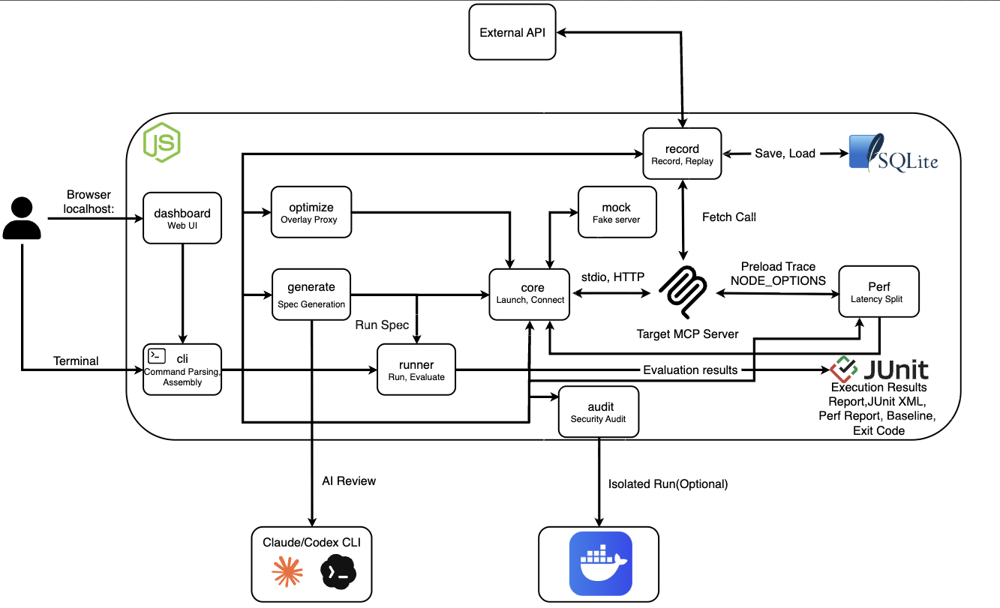

<h1 align="center">MCPeak</h1>

<p align="center"><b>A framework for testing MCP servers with code</b><br>
Start the server, check its responses, record and replay its outbound calls, or swap it for a mock — each with one command.</p>

<p align="center">
  <a href="https://www.npmjs.com/package/@mcpeak/cli"></a>
  <a href="./LICENSE"></a>
  
  <a href="https://github.com/2026-Engineering-Contest/MCPeak/actions/workflows/ci.yml"></a>
</p>

```bash
npm install -g @mcpeak/cli
mcpeak test weather.suite.json -- node ./server.js
```

<p align="center">
  <a href="https://2026-engineering-contest.github.io/MCPeak/"><b>Docs</b></a> ·
  <a href="https://2026-engineering-contest.github.io/MCPeak/quick-start">Quick start</a> ·
  <a href="https://2026-engineering-contest.github.io/MCPeak/reference/cli">CLI reference</a> ·
  <a href="https://2026-engineering-contest.github.io/MCPeak/faq">FAQ</a> ·
  <a href="./README.md">한국어</a>
</p>

Until now, the only way to know how an MCP (Model Context Protocol) server behaves was to attach it
to an LLM client and poke at it by hand. MCPeak turns that check into a JSON suite and a terminal
command. When a test fails, it prints in one line which assertion differs from what, why, and how
to fix it. HTTP calls the server makes through `globalThis.fetch` are recorded once and replayed
afterwards, so the same input always gives the same result. Even before the server code exists, you
can validate the design with a single mock definition file.

> **Note:** the CLI's own messages (failure reasons, fix hints, errors) are currently printed in
> Korean. The examples below show the output exactly as it appears, with English translations
> alongside.

## Getting started

Where you start depends on what you want to do.

| I want to | Command | Guide |
|---|---|---|
| Write a suite and test a server | `mcpeak test suite.json -- node ./server.js` | [Writing suites](https://2026-engineering-contest.github.io/MCPeak/guide/writing-suites) |
| Generate a suite from the server's schemas | `mcpeak generate --out suite.json -- node ./server.js` | [Generating suites](https://2026-engineering-contest.github.io/MCPeak/guide/generate) |
| Test against a mock instead of a server | `mcpeak test suite.json --command mcpeak-mock --arg mock.json` | [Mock server](https://2026-engineering-contest.github.io/MCPeak/guide/mock-server) |
| Record and replay external API calls | `mcpeak test suite.json --record-session s.db -- node ./server.js` | [External sessions](https://2026-engineering-contest.github.io/MCPeak/guide/external-sessions) |
| Fix failing cases with AI | `mcpeak repair bundle.json --provider claude --model <model>` | [Repair](https://2026-engineering-contest.github.io/MCPeak/guide/repair) |
| Check a server for security risks before using it | `mcpeak audit -- node ./server.js` | [Audit](https://2026-engineering-contest.github.io/MCPeak/guide/audit) |
| Shrink tool definitions before handing them to an LLM | `mcpeak optimize --out server.optimize.json -- node ./server.js` | [Optimize](https://2026-engineering-contest.github.io/MCPeak/guide/optimize) |
| Run it from a web UI | `mcpeak-dashboard` | [Dashboard](https://2026-engineering-contest.github.io/MCPeak/guide/dashboard) |
| Hook it into CI | `mcpeak test suite.json --junit out.xml -- node ./server.js` | [CI integration](https://2026-engineering-contest.github.io/MCPeak/guide/ci) |

## Installation

```bash
npm install -g @mcpeak/cli
```

This puts the `mcpeak` command on your `PATH`. If you only need it once, `npx @mcpeak/cli test ...`
runs it without installing. Requires Node 22.18 or later.

The mock server, the web UI, and the tool definition proxy are separate packages. A global install
only puts that package's own executable on `PATH`, so to use `mcpeak-mock`, `mcpeak-dashboard`, and
`mcpeak-optimize-proxy` you need to install them separately.

```bash
npm install -g @mcpeak/cli @mcpeak/mock @mcpeak/dashboard @mcpeak/optimize
```

## Your first test

Write what you want to test as a JSON suite.

```json
{
  "schemaVersion": 1,
  "id": "weather",
  "name": "Weather server",
  "cases": [
    {
      "id": "tool-exists",
      "name": "provides the get_weather tool",
      "operation": { "type": "listTools" },
      "assertions": [{ "type": "toolExists", "tool": "get_weather" }]
    },
    {
      "id": "seoul-succeeds",
      "name": "returns Seoul weather without error",
      "operation": { "type": "callTool", "tool": "get_weather", "input": { "city": "서울" } },
      "assertions": [{ "type": "isError", "expected": false }]
    }
  ]
}
```

(`"서울"` is "Seoul" — the example server's data is keyed by Korean city names.)

Pass it along with the command that starts the server. Everything after `--` is the server command.

```bash
mcpeak test weather.suite.json -- node examples/weather-server/server.mjs
```

```
Weather server  (2 cases)

✓ tool-exists     provides the get_weather tool
✓ seoul-succeeds  returns Seoul weather without error

2 passed  (2 total)
```

The example server lives in `examples/weather-server/` in this repository. If you installed from
npm only and have no server to attach, start with a mock server: keep the suite above as is, add one
mock definition JSON file, and the same two cases pass.

## When something fails

When a case fails, the output shows which assertion differs from what, why, and how to fix it.

```
✗ missing-tool  requires a tool that does not exist
    toolExists  툴 'missing_weather_tool'을(를) 찾을 수 없습니다. 발견된 툴: 'add', 'get_weather'
    해결: 서버의 tools/list 응답과 테스트 명세를 확인하세요.

1 failed  (1 total)
```

> Tool 'missing_weather_tool' not found. Tools found: 'add', 'get_weather'<br>
> Fix: check the server's tools/list response and your test suite.

When the run itself fails — the suite can't be read, the server can't be reached — the output shows
the cause code and how to fix it.

```
오류 [MCP_CONNECTION_FAILED/PROCESS_START_FAILED]: MCP 서버 프로세스를 시작하지 못했습니다.
해결: command 실행 가능 여부와 cwd를 확인하세요.
```

> Error [MCP_CONNECTION_FAILED/PROCESS_START_FAILED]: could not start the MCP server process.<br>
> Fix: check that the command is executable and that cwd is correct.

Both exit with code 1. The full output format is in the
[CLI reference](https://2026-engineering-contest.github.io/MCPeak/reference/cli).

## What makes it different

It is built on three principles.

- The failure message is the product. Instead of `expected true, got false`, it prints what differs,
  why, and how to fix it.
- The same input gives the same result. Calls the server makes through `globalThis.fetch` are
  recorded once and replayed, and a mock server's responses are values a person specified, so they
  always return the same bytes. Calls that don't go through `fetch`, such as `node:http` or axios,
  are outside the recording scope and really go out. With `--determinism`, the same suite runs twice
  and the results are compared. This comparison is a diagnostic that doesn't block the verdict, so
  the exit code stays the same even if they differ, and it only counts as a determinism check when
  `--reset-cmd` restores state between runs.
- You don't have to write every suite by hand. It reads the server's tool schemas, synthesizes
  valid and violating cases deterministically, and fingerprints only suites a person has approved.

How it works is in the [concepts page of the docs](https://2026-engineering-contest.github.io/MCPeak/concepts/how-it-works),
and every decision that "could have gone another way" gets a one-page record in [`docs/adr/`](./docs/adr)
(written in Korean).

## Architecture

<p align="center"></p>

Users run `cli` from a terminal and `dashboard` from a browser. `cli` builds suites with `generate`
and runs them with `runner`, and `runner` attaches to the target MCP over stdio or HTTP through
`core`. `record` stores the server's outbound `fetch` calls in a SQLite file and replays them, and
`mock` takes the place of the target server. `audit` reads the target server's tool definitions and
protocol responses to check for security risks, and `optimize` builds an overlay that shrinks tool
definitions without changing their meaning and serves it through a proxy. `generate`'s AI review
goes out to a locally installed Claude or Codex CLI. Results come out as a terminal report, JUnit
XML, and an exit code.

## Packages

| Package | Role |
|---|---|
| [`@mcpeak/cli`](./packages/cli) | CLI entry point. Kept thin |
| [`@mcpeak/core`](./packages/core) | MCP protocol client, transports, process lifecycle |
| [`@mcpeak/runner`](./packages/runner) | Declarative test execution, assertions, structured reports |
| [`@mcpeak/generate`](./packages/generate) | Test generation from a deterministic baseline plus approval-gated AI review |
| [`@mcpeak/record`](./packages/record) | Recording, replay, contract snapshots |
| [`@mcpeak/mock`](./packages/mock) | Mock MCP (Streamable HTTP, stdio), response injection |
| [`@mcpeak/audit`](./packages/audit) | Pre-use MCP security checks. Docker-isolated runs (`--sandbox`) |
| [`@mcpeak/optimize`](./packages/optimize) | Lossless tool definition compression, overlay proxy. Run with `mcpeak-optimize-proxy` |
| [`@mcpeak/dashboard`](./packages/dashboard) | Local web UI. Run with `mcpeak-dashboard` |

Dependencies flow one way: `dashboard` → `cli` → `runner`/`generate`/`record`/`mock`/`audit`/`optimize` → `core`.
A package may only depend on layers to its right, and may skip adjacent layers
([ADR-0091](./docs/adr/0091-패키지는-하위-계층을-직접-의존할-수-있다.md)).

## Development

```bash
corepack enable       # enable pnpm (uses the packageManager pin)
pnpm install
pnpm build            # builds dist/ for the 9 packages and the example servers
pnpm typecheck
pnpm test
pnpm lint
```

When working in the repository, call the build output instead of the installed copy, so your edits
take effect immediately.

```bash
node packages/cli/dist/cli.mjs test <suite.json> -- node ./server.js
```

If you skip `pnpm build`, you'll be running a stale `dist/`. Rebuild after changing source. CI checks
on Node 22.18.0 (the minimum) and Node 24.

The docs site source lives in `website/` and is deployed to GitHub Pages on every push to main.
If this is your first contribution, see the [contributing guide](./.github/CONTRIBUTING.md).

## License

[MIT](./LICENSE)
